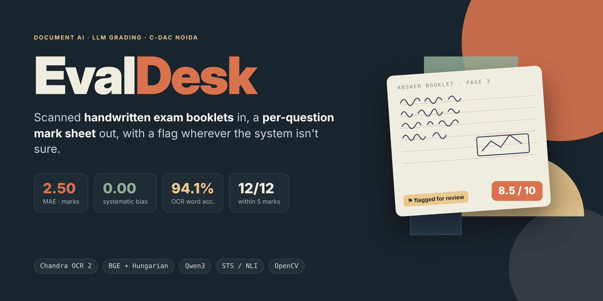
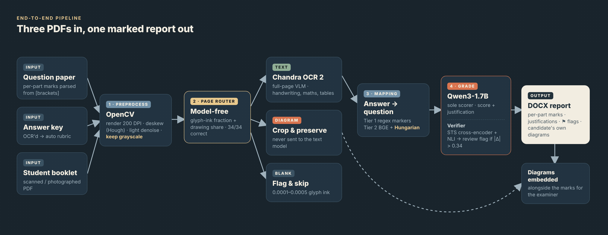
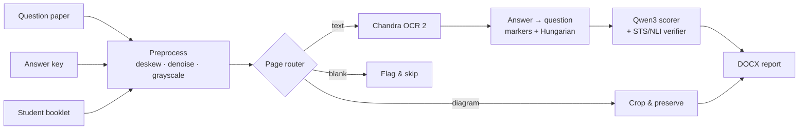
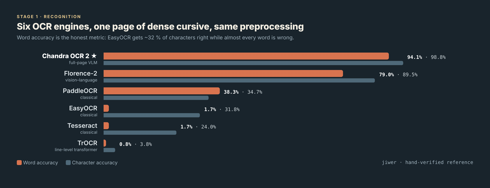
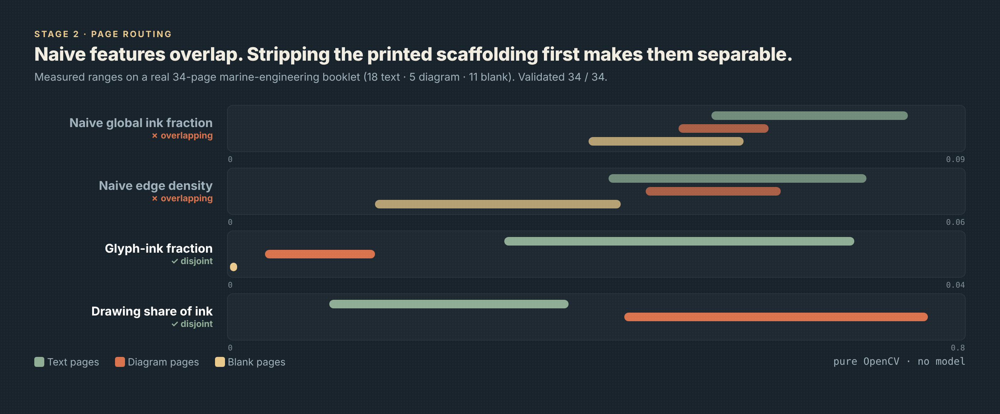
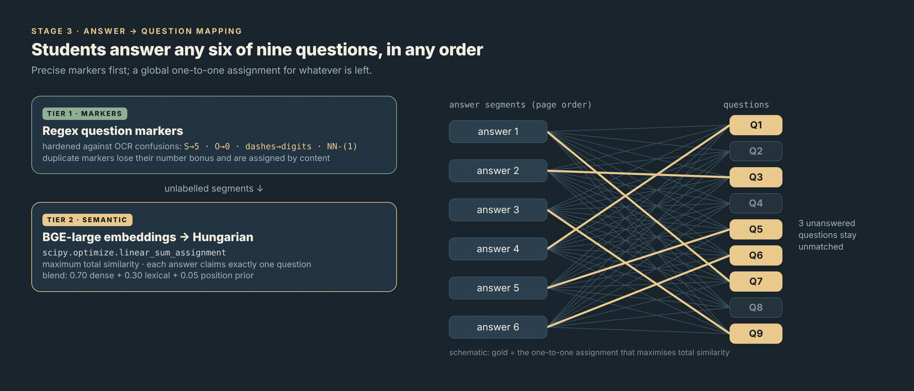
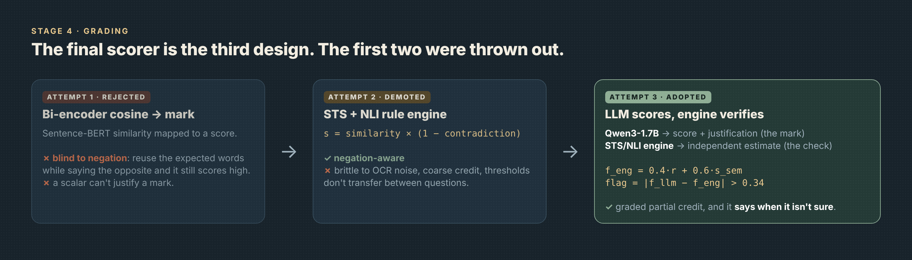
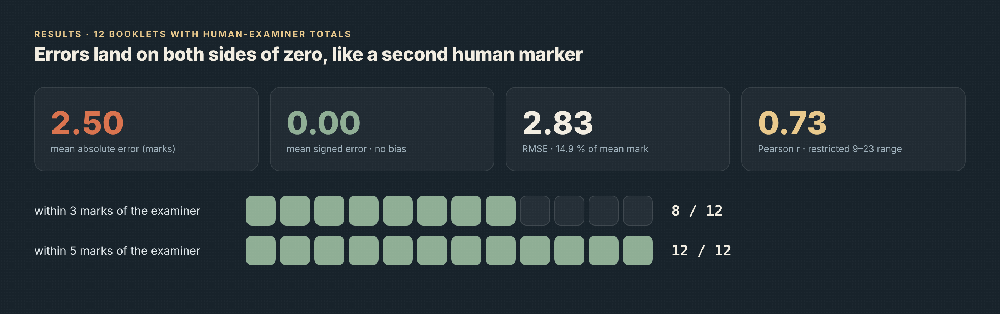

<p align="center"></p>

<p align="center">
  
  
  
  
  
  
  
</p>

**Automated evaluation of handwritten examination booklets — from scanned pages to a per-question mark sheet.**

EvalDesk takes three PDFs — a question paper, an answer key, and a scanned student booklet — and returns a marked report: per-part scores, short justifications, review flags on uncertain marks, and the candidate's own diagrams embedded alongside them.

Built during a research internship at **C-DAC Noida** (Summer Internship Programme 2026), supervised by Mr. Tushar Patnaik, with mentors Ms. Aakansha and Ms. Chandani. Team: Krishnarsh Sonkar, Nancy Garg.

**Measured against human examiners: mean absolute error 2.50 marks per booklet, mean signed error 0.00, all twelve booklets within five marks of the examiner total.**

---

## Why this is hard

The booklets are real technical examination scripts, and each of their properties breaks an assumption that automated graders usually make:

- **Answer order is unconstrained.** A candidate answers any six of nine questions in whatever order they like. The *k*-th answer on the page is not question *k*, so position-based alignment fails.
- **Content is mixed.** One booklet contains cursive prose, worked mathematics, and hand-drawn engineering diagrams. A recogniser tuned for printed text handles none of it.
- **Similarity is not correctness.** An answer can reuse every expected term while asserting the *negation* of the reference. Cosine similarity is blind to negation and will score it highly.

Each of the three design decisions below exists to address one of these.

---

## Pipeline

<p align="center"></p>

<details><summary>Same pipeline as a diagram you can read in plain text</summary>


</details>

### 1. Recognition — chosen by measurement, not assumption

Because OCR quality caps everything downstream, six engines were benchmarked on the same page of dense connected cursive under identical preprocessing, scored against a hand-verified transcription:

| Engine | Type | Word % | Char % |
|---|---|---:|---:|
| **Chandra OCR 2** | full-page document VLM | **94.12** | **98.82** |
| Florence-2 | vision–language | 78.99 | 89.54 |
| PaddleOCR | classical pipeline | 38.29 | 34.70 |
| EasyOCR | classical pipeline | 1.68 | 31.81 |
| Tesseract | classical pipeline | 1.68 | 24.01 |
| TrOCR | line-level transformer | 0.84 | 3.83 |

<p align="center"></p>

Two results are worth dwelling on.

**TrOCR finished last despite being the most specialised.** It is a transformer trained specifically on handwriting — and it lost to engines never trained on handwriting at all. The failure is architectural, not recognitional: TrOCR reads one pre-cut line at a time and has no model of page layout, so the page must first be segmented into line images. On dense slanted cursive, descenders of one line touch ascenders of the next and two lines merge into one blob; faint ruled lines survive thresholding and are read as text. A few bad cuts collapse the whole transcription. The recogniser never got a fair input.

**Character accuracy flatters failing engines.** EasyOCR records ~32% character accuracy at under 2% word accuracy — it emits letters that coincide with the reference by chance while nearly every word is wrong. Word accuracy is the honest headline when downstream stages operate on meaning.

A related finding shaped preprocessing: **heavy binarisation helps classical OCR and hurts vision–language models.** VLMs are trained on natural grayscale and depend on stroke detail that a harsh bitonal threshold destroys. Global Otsu and Sauvola binarisation were both tried and rejected; the OCR path keeps lightly-processed grayscale.

### 2. Page routing — a model-free classifier

A real booklet is not a stack of text pages. Sending a diagram to a full-page VLM is worse than sending nothing: the model dutifully "reads" the drawing and emits confident invented words that pollute the answer.

The obvious approach — threshold on global ink density or edge density — **fails**, and instructively so. Printed ruled lines, dotted scissor guides and the barcode band contribute most of the ink on every page, so the three classes overlap: a blank page can carry more ink than a diagram page.

The working detector strips the printed scaffolding *first*, then separates handwriting-sized connected components from drawing strokes:

| Feature | Text pages | Diagram pages | Blank pages |
|---|---|---|---|
| Naive global ink fraction | 0.059–0.083 | 0.055–0.066 | 0.044–0.063 |
| Naive edge density | 0.031–0.052 | 0.034–0.045 | 0.012–0.032 |
| **Glyph-ink fraction** | **0.015–0.034** | **0.002–0.008** | **0.0001–0.0005** |
| **Drawing share of ink** | **11–37%** | **43–76%** | — |

<p align="center"></p>

The naive rows overlap; the final rows are disjoint. That separation is why a simple rule works. Validated **34/34** on a real 34-page marine-engineering booklet (18 text, 5 diagram, 11 blank). Pure OpenCV — no extra model to train or load.

### 3. Answer-to-question mapping — order-independent

<p align="center"></p>

**Tier 1** detects written question markers by regular expressions hardened against characteristic OCR confusions (S read as 5, O as 0, dashes as digits, corrupted `NN-(1)` part markers). Duplicate markers from misrecognition have their number-match bonus suppressed so the block is assigned by content instead.

**Tier 2** handles whatever Tier 1 could not label. Each answer segment and each question is embedded with BGE-large-en-v1.5, and the resulting similarity matrix is solved for the maximum-total-similarity one-to-one assignment using the **Hungarian algorithm** (`scipy.optimize.linear_sum_assignment`). The assignment is order-independent and structurally prevents two answers claiming the same question. A content-anchored variant blends dense similarity (0.70), lexical overlap (0.30) and a small positional prior (0.05).

### 4. Grading — arrived at by discarding two simpler designs

This is the part I'd most want to be asked about in an interview, because the final design is the third attempt.

<p align="center"></p>

**Attempt 1 — bi-encoder similarity. Rejected.** Sentence-BERT cosine similarity mapped to a mark. Cheap and paraphrase-tolerant, but a bi-encoder encodes both texts independently and reports only how *close* they are. It cannot tell whether the candidate agrees with the reference or negates it, so answers reusing the expected vocabulary while stating the opposite scored like correct ones. A scalar also gives no basis for justifying a mark to a student.

**Attempt 2 — deterministic STS/NLI engine. Rejected as sole scorer.** A cross-encoder for semantic similarity (`stsb-roberta-large`) plus a natural-language-inference model (`roberta-large-mnli`) classifying entailment / contradiction / neutral, combined by the credit rule

```
s_sem = similarity × (1 − contradiction)
```

This is negation-aware and fixes attempt 1's core flaw. But applying a fixed decision rule to encoder outputs proved brittle: sensitive to OCR noise, awarding credit in coarse increments rather than the graded partial credit human markers use, and thresholds calibrated on one question did not transfer to others.

**Attempt 3 — LLM as sole scorer, deterministic engine demoted to verifier. Adopted.** An instruction-tuned `Qwen3-1.7B` receives the question, the reference answer and the candidate's answer, and returns a score with a brief justification. It tolerates OCR errors, assigns credit in fine increments, and applies the rubric without per-question calibration.

The STS/NLI engine is kept but **reassigned**: it independently assesses the same answer and, when the two estimates diverge, raises a review flag rather than overriding the mark.

```
f_eng = 0.4·r + 0.6·s_sem          (verification engine's internal grade)
flag  = |f_llm − f_eng| > τ,  τ = 0.34
```

The mark is the LLM's. The engine governs only the review decision. This keeps the negation-awareness of the contradiction gate while delegating graded partial credit to the model that's actually good at it — and it means **the system says when it isn't sure** instead of failing silently.

---

## Results

Twelve handwritten booklets, marked independently by human examiners, whose totals are ground truth:

<p align="center"></p>

| Metric | Value |
|---|---|
| Mean absolute error | **2.50 marks** |
| RMSE | 2.83 marks (14.9% of mean examiner mark) |
| Mean signed error | **0.00** — no systematic over- or under-marking |
| Within 3 marks of examiner | 8 / 12 |
| Within 5 marks of examiner | 12 / 12 |
| Pearson r | 0.73 |

The **zero signed error** matters more than the magnitude. A one-sided error pattern would indicate a structural fault — an unmapped answer scores zero and drags the total down while the rest of the booklet is unaffected. Errors distributed on both sides of zero are instead consistent with the ordinary disagreement that occurs between two human markers.

The **modest r = 0.73** should be read against the mark range: these booklets span roughly 9 to 23 marks, and a restricted range compresses correlation regardless of underlying accuracy. The error magnitudes characterise performance better than the correlation does.

Substituting a **larger** model from the same family changed agreement only marginally — evidence that residual error is governed by recognition noise, mapping, and rubric granularity rather than by scorer capacity. That is why the smaller model was kept.

---

## Models

| Model | Role |
|---|---|
| `datalab-to/chandra-ocr-2` | Page-level handwriting, equation and diagram OCR |
| `BAAI/bge-large-en-v1.5` | Bi-encoder embeddings for Tier-2 mapping |
| `cross-encoder/stsb-roberta-large` | Cross-encoder STS for grading verification |
| `roberta-large-mnli` | NLI contradiction / entailment gate |
| `Qwen/Qwen3-1.7B` | Sole scorer for prose answers |

Supporting stack: OpenCV (preprocessing, page classifier), PyMuPDF (PDF rendering at 200 DPI), sentence-transformers, rapidfuzz (OCR-tolerant rubric keyword matching), scipy (Hungarian assignment), python-docx (report generation), jiwer (WER/CER benchmarking).

---

## Running it

The notebook is written for Google Colab with a GPU runtime (developed on a T4; Chandra OCR 2 is ~10.6 GB, so a 16 GB GPU is the practical floor).

```bash
pip install "chandra-ocr[hf]" pymupdf sentence-transformers transformers \
            python-docx scipy pandas rapidfuzz markdown hf_transfer \
            bitsandbytes accelerate
```

Open `notebooks/EvalDesk_pipeline.ipynb` and run in three parts:

1. **Part 1 — Setup.** Runs once. Installs, loads Chandra OCR 2, the encoders and the grader.
2. **Part 2 — Question paper + answer key.** Runs once per examination. Extracts per-part marks from bracketed totals, OCRs the key, builds the rubric.
3. **Part 3 — Student booklet.** Re-run per student. OCR → mapping → grading → DOCX report.

No exam data is included in this repository.

---

## Known limitations

Stated plainly, because they're the honest boundary of what was built:

- **Diagram grading is unsolved.** Diagrams are reliably *detected* and preserved as cropped images (34/34), but reference diagrams are stored as textual captions, so a hand-drawn sketch is compared caption-to-caption. This generates unnecessary review flags on diagram-heavy questions. Comparing images visually — a VLM grader receiving the candidate's sketch alongside the reference — is the main direction for further work.
- **The page classifier is a tuned heuristic, not a learned model.** Thresholds were set from measured feature ranges on one booklet and may need re-tuning for very different handwriting, paper or scan quality. Half-text/half-diagram pages and light-pencil drawings remain the hard cases.
- **The scorer comparison is qualitative.** The three grading strategies were compared by observed behaviour during development, not by a controlled ablation against matched ground truth. Quantifying the LLM scorer's and the contradiction gate's separate contributions requires that ablation.
- **The evaluation set is small** — nineteen booklets from two examinations, twelve with examiner ground truth. Deployment at scale needs a larger study across multiple examiners reporting per-question agreement and inter-rater reliability.
- **Margin-written question numbers are occasionally lost** during recognition, leaving isolated part markers that place extra demands on the mapper.
- **Human review is assumed.** The design divides labour deliberately: the system does the heavy repetitive reading and first-pass scoring; a human retains final judgement. It is not a replacement for an examiner.

---

## Documentation

- [`docs/EvalDesk_internship_report.pdf`](docs/EvalDesk_internship_report.pdf) — 29-page final internship report covering the full engineering record, including the methods tried and rejected at every pipeline stage.
- A research paper, *"EvalDesk: A Vision–Language and Contradiction-Aware Framework for Automated Evaluation of Handwritten Examination Booklets"* (Sonkar, Garg, Aakansha, Chandani), is under review. It is not included here pending publication.

---

## Repository layout

```
evaldesk/
├── notebooks/
│   └── EvalDesk_pipeline.ipynb    # full pipeline, outputs cleared
├── docs/
│   └── EvalDesk_internship_report.pdf
├── assets/                        # figures used in this README
├── README.md
├── requirements.txt
└── LICENSE
```

## Acknowledgements

Developed at the Centre for Development of Advanced Computing (C-DAC), Noida, which hosted the project and provided the compute. Thanks to Mr. Tushar Patnaik for supervision and to Ms. Aakansha and Ms. Chandani for day-to-day guidance, and to Nancy Garg, co-developer on the project.

## License

MIT — see [LICENSE](LICENSE).
